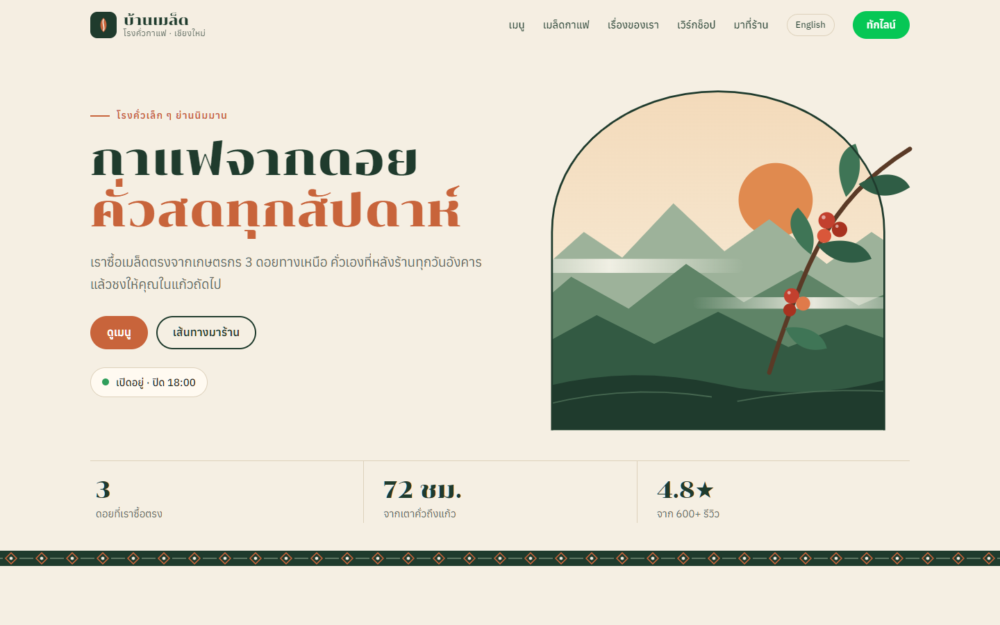

# บ้านเมล็ด (Baan Malet) — เว็บไซต์คาเฟ่ / โรงคั่วกาแฟ

เว็บไซต์ธุรกิจหน้าเดียว (landing page) สำหรับคาเฟ่และโรงคั่วกาแฟในเชียงใหม่ ภาษาไทยและอังกฤษ
**ธุรกิจนี้เป็นธุรกิจสมมติ** สร้างขึ้นเพื่อแสดงผลงานออกแบบและพัฒนาเว็บไซต์

**ดูเว็บจริง:** https://shswsy.github.io/baanmalet/ · [English](https://shswsy.github.io/baanmalet/en/)



## จุดเด่น

- ออกแบบเฉพาะ: ภาพประกอบ SVG วาดเอง ลายแถบแรงบันดาลใจจากล้านนา ฟอนต์ Chonburi + Anuphan
- **ป้ายเปิด/ปิดอัตโนมัติ** ตามเวลาไทย และไฮไลต์วันนี้ในตารางเวลาเปิด
- เมนูกรองตามหมวด, เมล็ดกาแฟพร้อมระดับคั่วและโน้ตรสชาติ
- **ปุ่ม LINE ส่งข้อความที่เตรียมไว้ให้** (เช่น "สนใจสั่งเมล็ด ดอยช้าง 200 กรัม") ลดขั้นตอนลูกค้า
- แผนที่ Google โหลดเมื่อแตะเท่านั้น (หน้าเว็บเร็วขึ้น ไม่มีคุกกี้บุคคลที่สามก่อนผู้ใช้ยินยอม)
- แถบปุ่มลัดบนมือถือ: โทร / LINE / นำทาง
- SEO: meta + Open Graph, `hreflang` ไทย/อังกฤษ, ข้อมูลโครงสร้าง schema.org `CafeOrCoffeeShop` (เวลาเปิด พิกัด ที่อยู่)
- เข้าถึงได้: skip link, ลำดับหัวข้อถูกต้อง, ใช้คีย์บอร์ดได้, รองรับ `prefers-reduced-motion`

## เทคโนโลยี

[Astro](https://astro.build) (static, JavaScript ฝั่งผู้ใช้น้อยมาก) · CSS ล้วน · GitHub Pages + GitHub Actions

เนื้อหาทั้งหมดอยู่ที่ `src/data/site.ts` ไฟล์เดียว เปลี่ยนเป็นข้อมูลร้านจริงได้โดยไม่ต้องแก้โครงหน้า

```bash
npm install
npm run dev     # http://localhost:4321/baanmalet/
npm run build   # ไฟล์ static อยู่ใน dist/
```
